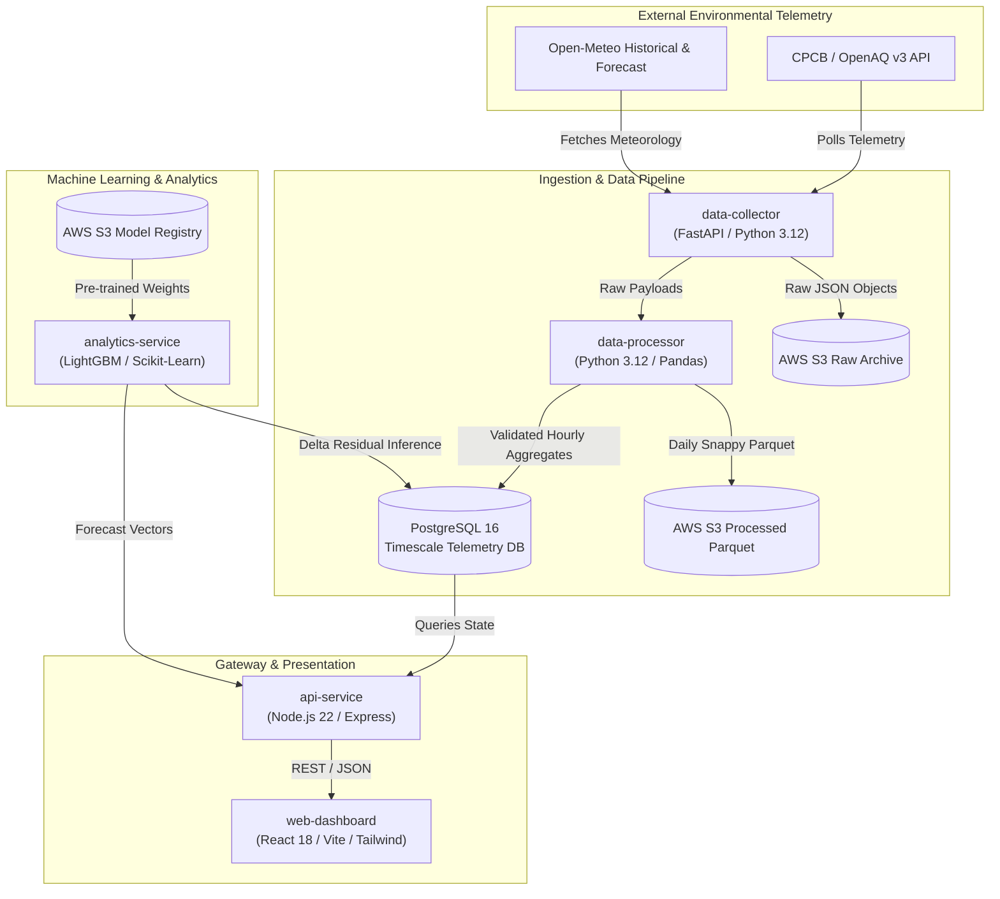
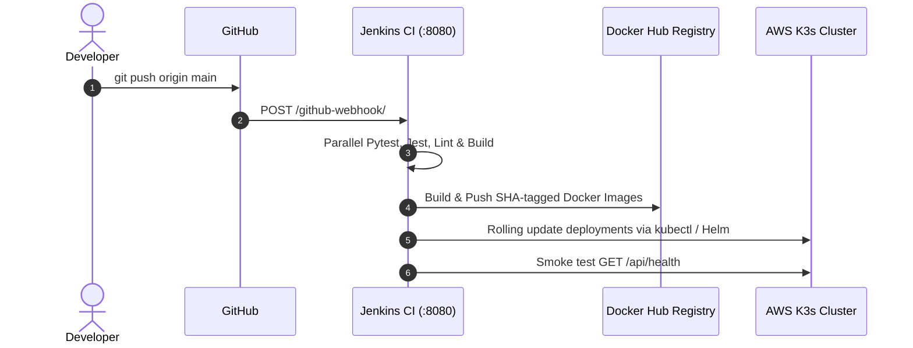

# 🌍 Urban Environmental Intelligence & Prediction Platform (UrbanEIIP)

[](http://13.206.193.63:8080)
[](https://aws.amazon.com)
[](https://k3s.io)
[](https://lightgbm.readthedocs.io)
[](LICENSE)

---

## 🚀 Live Public Deployment

The complete cloud-native infrastructure is actively provisioned and hosted on AWS with a dedicated Elastic IP:

| Component | Endpoint | Description |
| :--- | :--- | :--- |
| **🌐 Interactive Dashboard** | [http://app.13.206.193.63.nip.io](http://app.13.206.193.63.nip.io) | React Frontend with Multi-Metric Forecasting & On-Demand Telemetry Refresh |
| **🔌 API Gateway** | [http://api.13.206.193.63.nip.io](http://api.13.206.193.63.nip.io) | Node.js Express Gateway (Auth, Telemetry, Health, Inference Trigger) |
| **🩺 API Health Check** | [http://api.13.206.193.63.nip.io/health](http://api.13.206.193.63.nip.io/health) | Real-time service readiness & database connectivity verification |
| **📊 Grafana Observability** | [http://grafana.13.206.193.63.nip.io](http://grafana.13.206.193.63.nip.io) | Prometheus/Grafana real-time cluster telemetry, compute, and pod health |
| **⚙️ Jenkins CI/CD Console** | [http://13.206.193.63:8080](http://13.206.193.63:8080) | Continuous Integration & Automated Delivery Pipeline Controller |
| **🪝 GitHub Webhook URL** | `http://13.206.193.63:8080/github-webhook/` | Target URL configured in GitHub Repository Settings for automated build triggers |
| **📍 Dedicated Elastic IP** | `13.206.193.63` | Static AWS IPv4 Allocation (`ap-south-1`) |

> 🔒 **Administrative & Operational Credentials Notice:**  
> All administrative passwords, Jenkins credentials, and Grafana monitoring access tokens are strictly managed as protected secrets and are documented exclusively in [`DEPLOYMENT_AND_INFRASTRUCTURE_REPORT.md`](../DEPLOYMENT_AND_INFRASTRUCTURE_REPORT.md) (never committed to public repository documentation).

---

## 📖 Executive Summary

**Urban Environmental Intelligence & Prediction Platform (UrbanEIIP)** is a production-grade, distributed IoT and environmental telemetry platform designed for continuous air quality monitoring, automated anomaly detection, and forward-looking meteorological forecasting.

### Key Capabilities
- **Real-Time Telemetry Ingestion**: Asynchronous multi-threaded ingestion from Central Pollution Control Board (CPCB), OpenAQ, and Open-Meteo across key Indian metropolitan areas.
- **Delta-Residual Machine Learning**: Chronologically trained **LightGBM** models for PM2.5 and PM10 that predict delta movements against rolling baselines, eliminating static disparity.
- **Regional Meteorological Fallback**: Dynamic regional matrix ensuring high-availability ML inference (e.g. Pune/Ahmedabad $\to$ Mumbai, Lucknow/Jaipur $\to$ Delhi).
- **Interactive Multi-Metric Toggle**: Instant switching between `[ PM2.5 ]`, `[ PM10 ]`, and `[ Composite AQI ]` with official CPCB breakpoint interpolation.
- **On-Demand Force Refresh**: User-triggered live collection, S3 synchronization, and re-inference directly from the dashboard.
- **Ultra-Lean Resource Footprint**: Entire 5-service cluster runs inside ~650 MiB RAM on a single cost-optimized K3s node with 2 GB swap guard.

---

## 🏛️ System Architecture



---

## 📂 Repository Structure

```text
Urban-Environmental-Intelligence-Prediction-Platform/
├── Jenkinsfile                  # Declarative Jenkins CI/CD pipeline (SCM Webhook driven)
├── README.md                    # Platform documentation, live URLs & architecture guide
├── docker-compose.yml           # Single-command local developer environment
├── .env.example                 # Standardized environment template
├── .gitignore                   # Production gitignore rules (excludes secrets & extras)
│
├── services/                    # Microservices Source Code
│   ├── data-collector/          # Periodic & On-Demand Telemetry Ingestion (Python/FastAPI)
│   ├── data-processor/          # Telemetry cleaning, outlier filtering & hourly rollups
│   ├── analytics-service/       # LightGBM inference, regional fallback & AQI scoring
│   ├── api-service/             # Express.js REST gateway, JWT authentication & proxy
│   └── web-dashboard/           # Modern React SPA with interactive charts & metric toggles
│
├── terraform/                   # Infrastructure as Code (AWS)
│   ├── persistent/              # S3 Data Buckets (raw, processed, model registry)
│   └── compute/                 # EC2 (Ubuntu 22.04 LTS), Dedicated Elastic IP, Security Groups, K3s
│
├── helm/                        # Kubernetes Helm Charts
│   └── urban-platform/          # Parameterized microservices deployment & Ingress rules
│
├── k8s/                         # Raw Kubernetes Manifests (Fallback / Reference)
│
├── notebooks/                   # ML Training & Research Notebooks
│   └── urban_training.ipynb     # 180-day bootstrap, cross-validation & model gating
│
├── scripts/                     # Platform Automation
│   └── push_docker_images.sh    # Automated Docker Hub tagging and publishing
│
└── extras/                      # [GIT-IGNORED] Local Development & Test Artifacts
    ├── README.md                # Guide to offline test harnesses
    ├── scripts/                 # Reusable offline test scripts (e.g., seed_all_cities.py)
    ├── testing/                 # API mocks and unit testing harnesses
    └── scratch/                 # Intermediate test data & scratchpads
```

> **Note on `extras/`:** All local testing files, city seeders, and experimental test code are preserved inside `extras/`. This directory is strictly ignored by Git so that local testing can be repeated without cluttering the repository.

---

## 🛠️ Build & Run Your Own UrbanEIIP Stack

You can reproduce this entire architecture either locally using Docker Compose or on AWS using the provided Terraform configurations.

### Option A: Local Deployment (Docker Compose)

1. **Clone the repository:**
   ```bash
   git clone https://github.com/Akash123-cyber/Urban-Environmental-Intelligence-Prediction-Platform.git
   cd Urban-Environmental-Intelligence-Prediction-Platform
   ```

2. **Configure Environment:**
   ```bash
   cp .env.example .env
   # Edit .env if you wish to adjust poll intervals or add an OpenAQ API key
   ```

3. **Launch Microservices:**
   ```bash
   docker compose up -d
   ```

4. **Access Local Endpoints:**
   - **Web Dashboard:** [http://localhost:8080](http://localhost:8080)
   - **API Gateway:** [http://localhost:3000](http://localhost:3000)
   - **API Health:** [http://localhost:3000/health](http://localhost:3000/health)

---

### Option B: Cloud Deployment on AWS (Terraform + K3s)

#### 1. Prerequisites
- [AWS CLI v2](https://aws.amazon.com/cli/) configured with valid administrator credentials.
- [Terraform >= 1.5](https://www.terraform.io/downloads.html).
- An existing or imported EC2 Key Pair (`~/.ssh/id_rsa.pub` or similar).

#### 2. Provision Persistent Storage (S3 Buckets)
```bash
cd terraform/persistent
terraform init
terraform apply -auto-approve
```
*Outputs: `raw`, `processed`, and `models` S3 bucket names.*

#### 3. Upload Trained Model Artifacts
Upload the included LightGBM model weights to the newly created S3 model registry bucket:
```bash
# From repository root:
aws s3 sync data/models/ s3://<models-bucket-name>/
```

#### 4. Provision Compute Layer & Dedicated Elastic IP
```bash
cd ../compute
cp terraform.tfvars.example terraform.tfvars
```
Update `terraform.tfvars`:
```hcl
region          = "ap-south-1"
key_name        = "urban-eipp-key"
admin_cidrs     = ["0.0.0.0/0"]
bucket_names    = {
  raw       = "urban-eipp-407676141907-raw"
  processed = "urban-eipp-407676141907-processed"
  models    = "urban-eipp-407676141907-models"
}
docker_registry = "docker.io/akash123cyber"
docker_tag      = "latest"
```

Apply compute infrastructure:
```bash
terraform init
terraform apply -auto-approve
```

Terraform automatically provisions:
1. **Ubuntu 22.04 LTS EC2 Instance** with 2 GB Swap protection.
2. **Dedicated AWS Elastic IP** attached permanently to the node.
3. **AWS Security Group** with inbound access for HTTP (80), HTTPS (443), and Jenkins (8080).
4. **K3s Single-Node Kubernetes Cluster** with Ingress-Nginx controller.
5. **Jenkins CI/CD Server** running directly on port 8080.

---

## 🔄 Automated CI/CD with Jenkins & GitHub Webhooks

The platform features automated SCM-triggered CI/CD:



### Setting Up the GitHub Webhook
1. Go to your GitHub Repository $\to$ **Settings** $\to$ **Webhooks** $\to$ **Add webhook**.
2. **Payload URL**: `http://13.206.193.63:8080/github-webhook/`
3. **Content type**: `application/json`
4. **Events**: Select **Just the push event**.
5. Save the webhook. Every subsequent `git push` to `main` will automatically trigger parallel validation, container compilation, and rolling cluster deployment!

---

## 📊 Cluster Observability & Telemetry (Prometheus & Grafana)

The production cluster includes a fully integrated, cost-optimized Prometheus Operator and Grafana monitoring stack deployed via the `kube-prometheus-stack` Helm chart:

- **Live Grafana Console:** [http://grafana.13.206.193.63.nip.io](http://grafana.13.206.193.63.nip.io)
- **Active Scrape Targets (13):** Continuous metrics collection across Node Exporter, cAdvisor, Kube-State-Metrics, K3s control plane, and microservice `/metrics` endpoints.
- **Pre-Configured Dashboards:**
  - *Cluster & Node Compute Resources* (CPU, RAM, Disk I/O, Network Throughput).
  - *Namespace Workloads & Pod Health* (Pod restarts, container OOMs, and replica status).
  - *Alertmanager Status & Rules Overview*.
- **Right-Sized Resource Profiles:** Tuned specifically for cloud efficiency on `t3.medium` (averaging ~9% CPU and ~64% RAM utilization).

---

## 🧪 Local Testing & Seeding Harnesses

To seed telemetry or test without calling live CPCB endpoints repeatedly, use the scripts preserved in `extras/`:

```bash
# Seed telemetry across all target cities using historical Open-Meteo & OpenAQ data:
python extras/scripts/seed_all_cities.py
```

---

## 📜 License
This project is licensed under the MIT License — see the [LICENSE](LICENSE) file for details.
