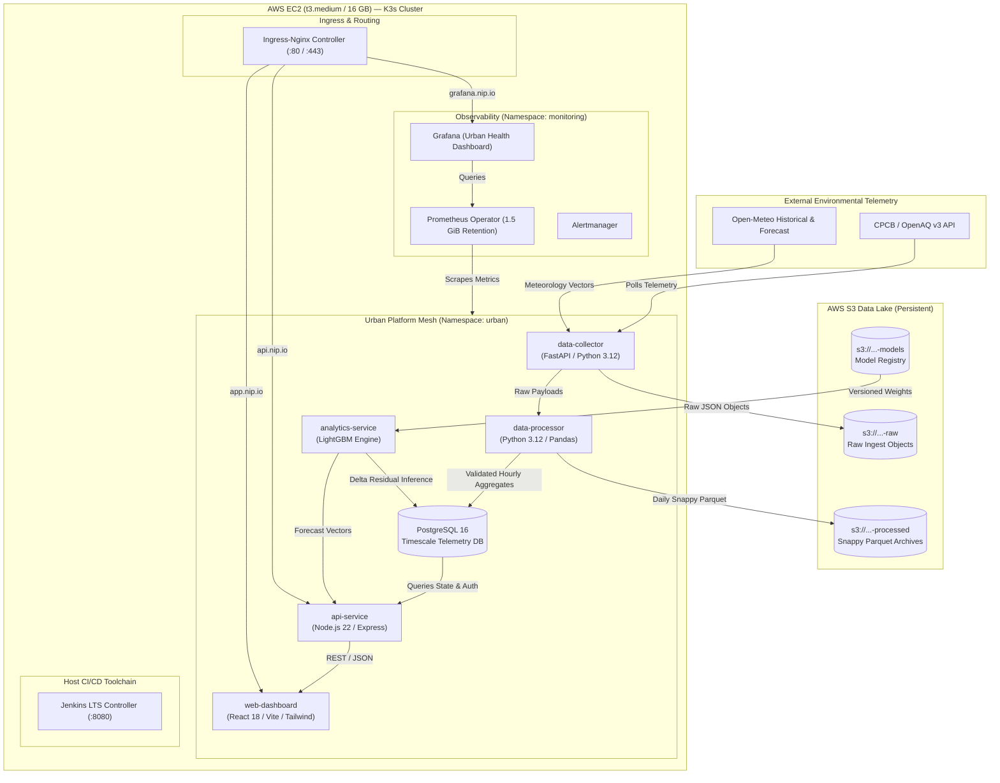
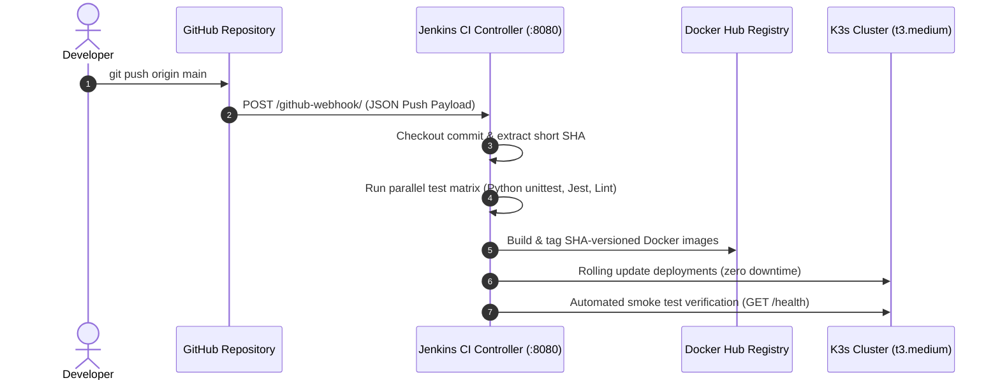

# 🌍 Urban Environmental Intelligence & Prediction Platform (UrbanEIIP)

[](http://13.206.193.63:8080)
[%20%7C%20S3%20%7C%20EIP-orange?logo=amazon-aws)](https://aws.amazon.com)
[](https://aws.amazon.com/ebs/)
[](https://k3s.io)
[](https://lightgbm.readthedocs.io)
[](http://grafana.13.206.193.63.nip.io)
[](LICENSE)

---

## 🚀 Live Public Deployment & Service Catalog

The entire cloud-native platform is provisioned and running live on AWS under a permanently preserved static Elastic IP in `ap-south-1` (Mumbai):

| Component | Public URL / Endpoint | Purpose & Functionality |
| :--- | :--- | :--- |
| **🌐 Interactive Dashboard** | [http://app.13.206.193.63.nip.io](http://app.13.206.193.63.nip.io) | Production React SPA featuring Live Telemetry, 24-hr Forecasts, Multi-Metric Switcher (`PM2.5`, `PM10`, `Composite AQI`), User Sign In & Sign Up |
| **🔌 API Gateway** | [http://api.13.206.193.63.nip.io](http://api.13.206.193.63.nip.io) | Express.js REST Gateway with JWT Authentication, Telemetry Query API, Anomaly Engine, and Force-Refresh Trigger |
| **🩺 API Health Endpoint** | [http://api.13.206.193.63.nip.io/health](http://api.13.206.193.63.nip.io/health) | Automated cluster readiness check, database connection pool status, and microservice health |
| **📊 Grafana Observability** | [http://grafana.13.206.193.63.nip.io](http://grafana.13.206.193.63.nip.io) | Real-time Prometheus dashboards, cluster resource graphs, pod memory working set, and platform health |
| **⚙️ Jenkins CI/CD Console** | [http://13.206.193.63:8080](http://13.206.193.63:8080) | Continuous Integration server with pipeline execution logs, test matrices, and automated deployment history |
| **🪝 GitHub Webhook URL** | `http://13.206.193.63:8080/github-webhook/` | Webhook endpoint configured in GitHub Repository Settings to trigger end-to-end CI/CD on every push |
| **📍 Dedicated Elastic IP** | `13.206.193.63` | Static AWS IPv4 address with lifetime persistence across infrastructure tear-down and re-provisioning |

> 🔒 **Security Notice:**  
> In compliance with strict production security standards, all administrative credentials, database passwords, Jenkins API tokens, and Grafana monitoring secrets are kept strictly separated from public repository documentation and are maintained exclusively in [`DEPLOYMENT_AND_INFRASTRUCTURE_REPORT.md`](../DEPLOYMENT_AND_INFRASTRUCTURE_REPORT.md).

---

## 💡 System Overview & Key Capabilities

**Urban Environmental Intelligence & Prediction Platform (UrbanEIIP)** is an enterprise-grade IoT and environmental analytics platform designed to solve the challenges of urban air quality monitoring and forward-looking meteorological forecasting in Indian metropolitan centers (Delhi, Mumbai, Kolkata, Chennai, Bengaluru).

### Core Features

1. **Multi-Source Real-Time Telemetry Ingestion**
   - Polls environmental data asynchronously from the Central Pollution Control Board (CPCB), OpenAQ v3 API, and Open-Meteo meteorological models.
   - Fault-tolerant ingestion pipelines with automatic retry backoff, circuit breaking, and raw JSON payload archiving into Amazon S3.

2. **Delta-Residual Machine Learning Inference**
   - Implements chronological **LightGBM Delta Residual** regressors for PM2.5 and PM10. Rather than predicting raw volatile particulate counts directly, models predict the expected delta displacement ($\Delta$) relative to rolling diurnal and meteorological baselines.
   - Eliminates static divergence between observation sites and model predictions.

3. **Regional Meteorological Fallback Architecture**
   - High-availability regional inference fallbacks allow uninterrupted forecasting even when local weather telemetry sensors experience outages (e.g. Pune/Ahmedabad fallback to Western Deccan/Mumbai profiles; Jaipur/Lucknow fallback to Northern Gangetic/Delhi profiles).

4. **Interactive Multi-Metric Switcher & AQI Interpolation**
   - Single-click toggle between `[ PM2.5 ]`, `[ PM10 ]`, and `[ Composite AQI ]`.
   - Real-time piecewise sub-index interpolation according to official National Air Quality Index (NAQI) guidelines.

5. **Self-Service User Sign Up & Authentication (Zero Schema Changes)**
   - Allows new users to register and sign in directly from the UI.
   - Built on top of the existing PostgreSQL `users` table (`id`, `email`, `password_hash`, `role`, `created_at`) with bcrypt password hashing (salt rounds: 10) and signed JWT tokens — **requiring zero database migrations or breaking schema modifications**.

6. **Automated MLOps S3 Data Lake & Model Registry**
   - Continuous raw ingestion telemetry is preserved as Snappy-compressed Parquet files in Amazon S3.
   - Model training pipelines (e.g., in Google Colab or cloud workers) export versioned artifacts (`lightgbm_pm25_vX.Y.Z.txt`, `lightgbm_pm10_vX.Y.Z.txt`) to the S3 Model Registry bucket.
   - Microservices dynamically detect, download, and hot-reload the latest semantic model version on startup and periodic sync.

---

## 🖥️ Production Hardware Architecture & Optimization

### Hardware Sizing

The platform is strictly deployed on a cost-effective, budget-conscious AWS footprint:
- **Instance Type:** `t3.medium` (2 vCPUs Intel Xeon Platinum 8259CL, 4.0 GiB RAM)
- **Root Block Storage:** **16 GB gp3 EBS Volume** (Strictly $\le$ 16 GB constraint)
- **Swap Protection:** 2.0 GiB NVMe Swap file with `vm.swappiness=10`

### Engineering for 16 GB Block Store on Single-Node Kubernetes

Running a full production microservices mesh (5 application services + PostgreSQL 16 + Ingress-Nginx + Prometheus Operator + Alertmanager + Grafana + Jenkins CI/CD Controller) on a single 16 GB root volume typically causes disk exhaustion (`The node had condition: [DiskPressure]`) because standard K3s runs its own internal `containerd` runtime in addition to the host Docker daemon, duplicating multi-gigabyte container image layers.

To eliminate this overhead and guarantee stable long-term operation on 16 GB disk, the platform incorporates four critical architectural optimizations:

1. **Docker CRI Integration (`--docker`)**
   K3s is configured with `--docker`, delegating all container runtime operations directly to the host Docker daemon. K3s and Docker share the exact same storage pool (`/var/lib/docker`), eliminating layer duplication and reclaiming over 3.5 GB of disk space.
2. **Kubelet Garbage Collection Tuning**
   Aggressive image and filesystem thresholds prevent disk pressure eviction:
   ```text
   --kubelet-arg=image-gc-high-threshold=85
   --kubelet-arg=image-gc-low-threshold=80
   --kubelet-arg=eviction-hard=imagefs.available<5%,nodefs.available<5%
   ```
3. **OS Footprint Reduction**
   Canonical Snap daemon (`snapd`) and legacy packages are purged during cloud-init, reclaiming ~800 MB.
4. **JVM Heap Sizing**
   The Jenkins LTS container JVM is bounded to `-Xms256m -Xmx512m`, ensuring the CI/CD controller never competes with Kubernetes workloads for memory.

---

## 🏛️ System Architecture



---

## 📂 Modular Repository & Terraform Structure

The repository follows an industry-standard root-and-module structure for **One-Click Infrastructure as Code**:

```text
Urban-Environmental-Intelligence-Prediction-Platform/
├── Jenkinsfile                  # SCM Webhook-driven Declarative CI/CD Pipeline
├── README.md                    # Platform documentation, live URLs & architecture guide
├── DEPLOYMENT_AND_INFRASTRUCTURE_REPORT.md  # Detailed operational report & access credentials
├── docker-compose.yml           # Local multi-container development environment
├── .env.example                 # Standardized environment template
│
├── terraform/                   # Production AWS Infrastructure as Code
│   ├── main.tf                  # Root orchestration calling persistent & compute modules
│   ├── variables.tf             # Input variable definitions with defaults
│   ├── outputs.tf               # Infrastructure outputs (IPs, URLs, Bucket Names)
│   ├── versions.tf              # Provider constraints (AWS >= 5.0, Terraform >= 1.5)
│   ├── terraform.tfvars         # Active deployment configuration variables
│   │
│   └── modules/
│       ├── persistent/          # Decoupled S3 Data Lake & Static Elastic IP
│       │   ├── main.tf          # S3 buckets (raw, processed, models) & EIP
│       │   ├── variables.tf
│       │   └── outputs.tf
│       │
│       └── compute/             # Ephemeral Compute Node
│           ├── main.tf          # EC2 instance (t3.medium), IAM role, Security Group, EIP attachment
│           ├── variables.tf
│           ├── outputs.tf
│           └── templates/
│               └── user_data.sh.tftpl  # Zero-touch cloud-init bootstrap script
│
├── scripts/
│   ├── provision.sh             # One-click provisioning script (terraform init & apply)
│   ├── destroy.sh               # Safe destroy script (preserves Elastic IP & S3 buckets)
│   └── push_docker_images.sh    # Docker Hub container publishing automation
│
├── services/                    # Microservices Source Code
│   ├── data-collector/          # Periodic & On-Demand Telemetry Ingestion (Python/FastAPI)
│   ├── data-processor/          # Telemetry cleaning, outlier filtering & hourly rollups
│   ├── analytics-service/       # LightGBM inference, regional fallback & AQI scoring
│   ├── api-service/             # Express.js REST gateway, JWT authentication (Sign In & Sign Up)
│   └── web-dashboard/           # React 18 SPA with interactive charts & metric toggles
│
├── monitoring/                  # Observability Definitions
│   ├── kube-prometheus-stack-values.yaml  # Tuned Helm values for t3.medium
│   └── dashboards/
│       └── urban-health.json    # Custom Grafana Urban Health Dashboard definition
│
└── k8s/                         # Kubernetes Manifests
    ├── 00-namespace.yaml        # Namespace definition (urban)
    ├── 01-configmap.yaml        # Platform configuration
    ├── 10-postgres.yaml         # PostgreSQL 16 Deployment & Service
    ├── 20-data-processor.yaml   # Data Processor Deployment & Service
    ├── 21-data-collector.yaml   # Data Collector Deployment & Service
    ├── 22-analytics-service.yaml# Analytics Engine Deployment & Service
    ├── 23-api-service.yaml      # API Gateway Deployment & Service
    ├── 24-web-dashboard.yaml    # React Web Dashboard Deployment & Service
    ├── 30-ingress.yaml          # Ingress-Nginx routing rules (nip.io)
    └── 40-servicemonitor.yaml   # Prometheus ServiceMonitor definition
```

---

## ⚡ One-Click Infrastructure Provisioning & Destruction

The infrastructure is engineered for complete one-click provisioning with **zero manual shell configuration**.

### 1. One-Click Provisioning

To provision or re-provision the entire platform from scratch:

```bash
# From repository root:
./scripts/provision.sh
```

**What happens automatically:**
1. Terraform initializes and reads `terraform/terraform.tfvars`.
2. S3 Data Lake buckets (`raw`, `processed`, `models`) and the static AWS Elastic IP (`13.206.193.63`) are verified or created.
3. The `t3.medium` EC2 node is launched with 16 GB gp3 storage.
4. Cloud-init executes `user_data.sh.tftpl`:
   - Configures Docker CRI and installs K3s with `--docker`.
   - Provisions Ingress-Nginx controller.
   - Deploys PostgreSQL 16 with schema and historical 96-hour telemetry seeds.
   - Pre-builds and launches all 5 microservices in namespace `urban`.
   - Deploys Prometheus Operator and Grafana with pre-loaded `Urban Platform — Service Health` dashboard.
   - Bootstraps Jenkins LTS controller on port 8080 with pre-configured pipeline job `UrbanEIIP-Pipeline`.
   - Automatically triggers the initial Jenkins CI/CD build run.

### 2. Safe Destruction (Preserving Static Elastic IP)

To tear down the compute instance while **protecting the Elastic IP and S3 Data Lake buckets**:

```bash
# From repository root:
./scripts/destroy.sh
```

**Why this matters:**
The static Elastic IP (`13.206.193.63`) is configured with `lifecycle { prevent_destroy = true }` in `modules/persistent`. The destroy script selectively destroys `module.compute`:
```bash
terraform destroy -target=module.compute -auto-approve
```
This safely terminates the EC2 instance and releases computing costs without releasing the Elastic IP. When you re-provision with `./scripts/provision.sh`, the new instance automatically reattaches to `13.206.193.63`, ensuring **GitHub Webhooks and DNS/nip.io links never break**.

---

## 🔄 Automated CI/CD Pipeline (Jenkins & GitHub Webhooks)

The platform features an automated, SCM-triggered continuous integration and delivery pipeline:



### GitHub Webhook Configuration
1. In your GitHub repository, navigate to **Settings** $\to$ **Webhooks** $\to$ **Add webhook**.
2. **Payload URL:** `http://13.206.193.63:8080/github-webhook/`
3. **Content type:** `application/json`
4. **Events:** Select **Just the push event**.
5. Save the webhook. Every push to `main` triggers Jenkins automated testing and rolling deployment.

---

## 📊 Observability & Monitoring (Prometheus & Grafana)

The production cluster includes a dedicated monitoring stack tuned for the `t3.medium` memory footprint:

- **Grafana URL:** [http://grafana.13.206.193.63.nip.io](http://grafana.13.206.193.63.nip.io)
- **Pre-Loaded Dashboard:** `Urban Platform — Service Health` (`UID: urban-health`)
  - **Pod CPU Consumption:** Real-time vCPU core usage per pod.
  - **Pod Memory Working Set:** Resident set tracking against memory limits.
  - **Request Rates & Error Ratios:** Real-time HTTP request throughput and 5xx error ratios.
  - **p95 Latency:** 95th percentile latency tracking across all API routes.
  - **Ingestion Throughput:** Records ingested per minute by city.
  - **Cluster Node Health:** CPU load, memory headroom, and unready pod count.

---

## 🧪 Local Developer Environment (Docker Compose)

To run the complete platform locally without AWS:

```bash
# 1. Clone repository
git clone https://github.com/Akash123-cyber/Urban-Environmental-Intelligence-Prediction-Platform.git
cd Urban-Environmental-Intelligence-Prediction-Platform

# 2. Copy environment template
cp .env.example .env

# 3. Start services
docker compose up -d

# 4. Access local services
# Web Dashboard: http://localhost:8080
# API Gateway:   http://localhost:3000
# API Health:    http://localhost:3000/health
```

---

## 📜 License
This project is licensed under the MIT License — see the [LICENSE](LICENSE) file for details.
