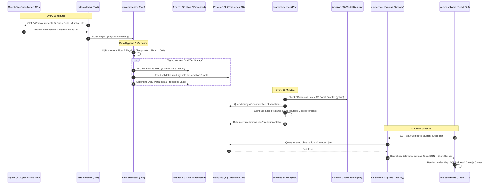

# Urban Environmental Intelligence & Prediction Platform
## Architecture, Microservices, S3 Storage & Local Testing Guide

---

## 1. Apache2 vs. Cloud-Native K3s Ingress

### Do we need Apache2 on the EC2 host?
**No. Apache2 is NOT required on the EC2 machine.**

### How Traffic is Handled in our Cloud-Native Architecture:
In traditional legacy deployments, administrators installed Apache2 or Nginx directly onto the host virtual machine (`apt-get install apache2`) to act as a reverse proxy. In modern Kubernetes cloud architectures, this is considered an anti-pattern.

Instead, our platform uses **containerized Ingress Routing**:
1. **Host Level:** The EC2 host runs a minimal Ubuntu 24.04 LTS OS with only the K3s agent/server running. No web servers, databases, or runtime dependencies are installed on the host.
2. **Cluster Ingress:** An **Ingress-Nginx Controller** runs as a Kubernetes pod. It binds directly to ports `80` (HTTP) and `443` (HTTPS) using `hostPort: true`.
3. **Frontend Serving:** The React web application is built into static HTML/CSS/JS bundles and packaged inside the `web-dashboard` Docker container, which runs an internal lightweight **Alpine NGINX** server on port `80`.
4. **Traffic Flow:**
   ```
   Internet Request (Port 80/443) 
         │
         ▼
   AWS Security Group (allows 80/443)
         │
         ▼
   EC2 Host Network (0.0.0.0:80 / 443)
         │
         ▼
   Kubernetes Ingress-Nginx Controller Pod
         │
         ├── Host: app.<EIP>.nip.io ──► web-dashboard Service (Port 80) ──► NGINX Container
         └── Host: api.<EIP>.nip.io ──► api-service Service (Port 3000) ──► Express.js Container
   ```

**Benefits:**
* **Zero host pollution:** If the EC2 instance is terminated and recreated, the entire web server and proxy configuration re-deploys automatically in under 3 minutes via Kubernetes manifests.
* **Declarative Routing:** Ingress rules are managed as version-controlled Kubernetes YAML files (`30-ingress.yaml`), not manual Apache virtual host files.

---

## 2. Microservices Architecture in Industry: Docker Images & Kubernetes Pods

### Why Industry Moved from Monoliths to Microservices
In a monolithic application, the data collector, data cleaner, machine learning engine, REST API, and frontend run within a single large codebase and single operating system process.
* If the ML training runs out of memory (OOM), the user-facing web dashboard crashes.
* If the OpenAQ API changes or timeouts, the entire application blocks.
* Scaling requires scaling the entire monolith rather than just the bottlenecked service.

Microservices split the system into **autonomous, decoupled services** that communicate over lightweight network protocols (HTTP/REST, gRPC, or message queues).

---

### Understanding the Hierarchy: Code -> Docker Image -> Pod -> Service -> Deployment

```
+------------------------------------------------------------------------------------+
| 1. SOURCE CODE (Git Repository)                                                    |
|    Individual services: data-collector, data-processor, analytics, api, dashboard    |
+------------------------------------------------------------------------------------+
                                      │
                               Docker Build
                                      ▼
+------------------------------------------------------------------------------------+
| 2. DOCKER IMAGE (Immutable Build Artifact in Docker Hub)                           |
|    e.g., docker.io/malikakash/data-processor:latest                                |
|    Contains: Linux Alpine/Debian base OS + Python runtime + dependencies + code    |
+------------------------------------------------------------------------------------+
                                      │
                               Kubernetes Pull
                                      ▼
+------------------------------------------------------------------------------------+
| 3. KUBERNETES POD (Atomic Unit of Execution)                                       |
|    - Contains the running container(s)                                             |
|    - Allocated an internal Cluster IP (e.g., 10.42.0.15)                           |
|    - Shares network namespace (localhost) and storage volumes                     |
|    - Subject to CPU and Memory limits (e.g., 250m CPU, 256Mi RAM)                  |
+------------------------------------------------------------------------------------+
                                      │
                               Managed By
                                      ▼
+------------------------------------------------------------------------------------+
| 4. KUBERNETES DEPLOYMENT & SERVICE                                                 |
|    - Deployment: Ensures desired number of Pods run (self-healing & rolling updates) |
|    - Service: Stable internal DNS name & load balancer                             |
|      (e.g., http://data-processor:5000 routes to healthy processor pods)           |
+------------------------------------------------------------------------------------+
```

### The 5 Microservices in Urban EIPP:

| Microservice | Technology | Responsibility | Isolation & Resilience |
| :--- | :--- | :--- | :--- |
| **`data-collector`** | Python 3.11 | Scheduled background daemon polling OpenAQ & Open-Meteo REST APIs | Has **no database credentials**. Cannot tamper with SQL tables; forwards validated JSON to processor. |
| **`data-processor`** | Python / FastAPI | Statistical hygiene (IQR anomaly detection, physical boundary validation), S3 archiving | Sole owner of database inserts for raw telemetry; writes cold snapshots to S3. |
| **`analytics-service`**| Python / XGBoost | Lazy-loads ML models from S3; runs 24h multi-step delta forecasts | Read-only access to S3 models; writes predictions to PostgreSQL. Heavy ML compute isolated from API. |
| **`api-service`** | Node.js / Express | JWT authentication, RBAC, high-concurrency client REST queries | Connects only to PostgreSQL; has **no AWS/S3 credentials**, protecting data lake from web exploits. |
| **`web-dashboard`** | React + Vite + Nginx | Client-side Leaflet GIS mapping, Chart.js time-series visualizations | Pure client static asset container; zero server-side state. |

---

## 3. Weather & Environmental Data: S3 Storage Architecture & End-to-End Data Flow

### S3 Bucket Architecture (Decoupled & Encrypted)
Urban EIPP uses three isolated S3 buckets managed by Terraform:

1. **Raw Bucket (`urban-eipp-dev-<account_id>-raw`)**:
   * **Format:** Unaltered JSON payloads received from OpenAQ and Open-Meteo.
   * **Key Schema:** `raw/year=YYYY/month=MM/day=DD/city_id=<id>/timestamp=<epoch>.json`
   * **Lifecycle:** Auto-expires after **90 days** via S3 Lifecycle Rules to eliminate unnecessary cloud storage fees.
   * **Purpose:** Audit compliance and re-playable telemetry for model backtesting.

2. **Processed Bucket (`urban-eipp-dev-<account_id>-processed`)**:
   * **Format:** Cleaned, schema-validated Apache Parquet columnar files.
   * **Key Schema:** `processed/year=YYYY/month=MM/city=<city_slug>.parquet`
   * **Lifecycle:** Retained indefinitely for long-term historical environmental research.

3. **Model Registry Bucket (`urban-eipp-dev-<account_id>-models`)**:
   * **Format:** Serialized Delta XGBoost bundles (`.joblib`).
   * **Key Schema:** `models/latest/<city_slug>_<target>.joblib`
   * **Security:** IAM permissions set to **Strictly Read-Only** for the EC2 cluster to prevent running pods from overwriting model weights.

---

### Polling Cadence & Execution Frequency

* **Atmospheric Ingestion:** Every **15 minutes** (`POLL_INTERVAL_SECONDS = 900`).
* **Lookback Horizon:** 2 trailing hours to capture any delayed sensor uploads.
* **Predictive ML Retraining / Forecast Horizon:** Every **30 minutes** (`ANALYTICS_INTERVAL_SECONDS = 1800`), generating 24 future hourly predictions.
* **Frontend Refresh Cadence:** Automatic client-side poll every **60 seconds** via React `setInterval`.

---

### End-to-End Data Flow Diagram



---

## 4. Local Testing Workflow & Google Drive Model Integration

Before deploying to AWS, you can validate the full microservices fleet on your local computer using `docker compose`.

### Step 1: Transferring Your Trained Models from Google Drive

The `analytics-service` expects model bundles in `.joblib` format named according to this convention:
```text
<city_slug>_<target>.joblib
```
Examples:
* `delhi_pm25.joblib`
* `delhi_pm10.joblib`
* `mumbai_pm25.joblib`
* `mumbai_pm10.joblib`
* `kolkata_pm25.joblib`
* `kolkata_pm10.joblib`
* `chennai_pm25.joblib`
* `chennai_pm10.joblib`
* `bengaluru_pm25.joblib`
* `bengaluru_pm10.joblib`

#### How to provide the models:

* **Method A (Direct Local Copy — Recommended):**
  1. Open Google Drive in your web browser.
  2. Right-click your `models` folder and click **Download** (it will download as `models.zip`).
  3. Extract the folder and move the `.joblib` files into:
     ```bash
     mkdir -p "/home/akash/Antigravity/Urban Environmental Intelligence & Prediction Platform/urban-env-platform/data/models"
     ```
  4. Place the `.joblib` files directly inside that directory.

* **Method B (Google Drive Public Link via `gdown`):**
  1. In Google Drive, right-click the `models` folder -> **Share** -> Change general access to **"Anyone with the link can view"** -> Copy link.
  2. Provide that link here in the chat.
  3. We can download it automatically via `gdown`:
     ```bash
     ~/myEnv/bin/pip install gdown
     ~/myEnv/bin/gdown --folder "<YOUR_GDRIVE_FOLDER_URL>" -O "urban-env-platform/data/models"
     ```

---

### Step 2: Running the Entire Stack Locally with Docker Compose

The repository already includes a complete local production-parity environment in `urban-env-platform/docker-compose.yml`:
* Local PostgreSQL database with automated schema migration (`db/init.sql`)
* Local MinIO (S3-compatible object storage emulator)
* All 5 microservices running in isolated containers connected via an internal bridge network

#### Commands to start testing locally:
```bash
cd "/home/akash/Antigravity/Urban Environmental Intelligence & Prediction Platform/urban-env-platform"

# 1. Build all 5 microservice images locally
docker compose build

# 2. Start PostgreSQL, MinIO, and data services in the background
docker compose up -d

# 3. Check health and pod status
docker compose ps
```

#### Accessing Local Services in Browser:
* **Web Dashboard:** [http://localhost:3000](http://localhost:3000) (or via Nginx on port 80/8080)
* **REST API Gateway:** [http://localhost:8000/health](http://localhost:8000/health)
* **MinIO Storage Console:** [http://localhost:9001](http://localhost:9001) (User: `minioadmin` / Pass: `minioadmin`)
* **PostgreSQL Database:** `localhost:5432` (`user: urban`, `db: urban`)
